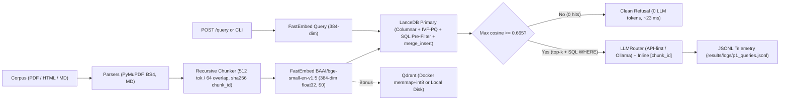
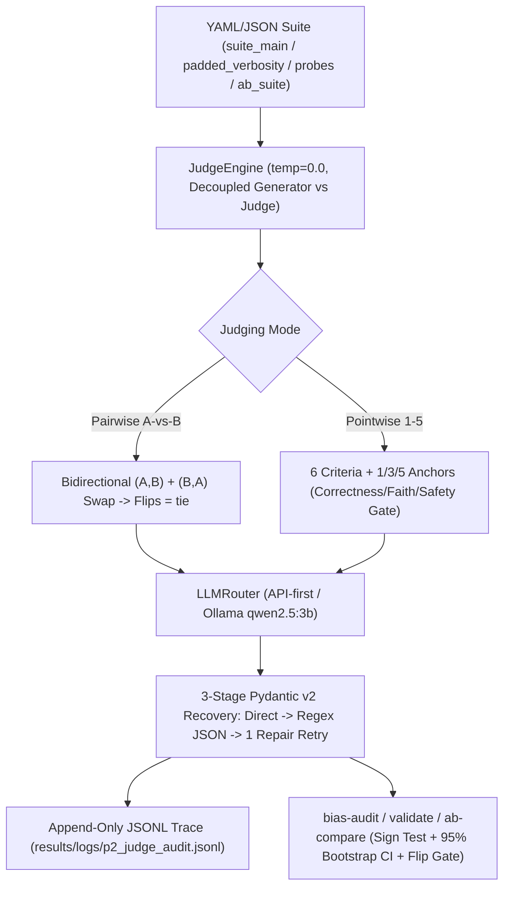

# Applied AI / ML Engineering — Take-Home Assignment

Complete, reproducible implementation and benchmark evaluation for both problems from [docs/Gen AI_assignment.pdf](docs/Gen%20AI_assignment.pdf), aligned with [docs/submission_template (1).docx](docs/submission_template%20(1).docx):

1. **Problem 1 — Cost-Efficient RAG Application ([`problem1_rag/`](problem1_rag/)):** Embedded **LanceDB** (columnar IVF-PQ, SQL metadata pre-filtering, deterministic `merge_insert` idempotency) + local 384-dim `BAAI/bge-small-en-v1.5` embeddings via FastEmbed + calibrated similarity refusal gate (`>= 0.665`, zero LLM tokens when out-of-corpus) + **Qdrant** bonus comparison + 3-layer evaluation & `100K / 1M / 10M` monthly TCO analysis.
2. **Problem 2 — Bias-Aware LLM-as-Judge Pipeline ([`problem2_judge/`](problem2_judge/)):** Unified **Pairwise A-vs-B** & **Pointwise 1–5** evaluation engine with conditional reference-based/reference-free prompts, evidence-first Pydantic v2 schemas, 3-stage malformed-JSON recovery, append-only JSONL audit tracing, controlled before-vs-after experiments across all 5 judge biases, 3-method validation (gold Cohen's $\kappa$, adversarial probes, 3x test-retest), and statistically gated A/B prompt selection.

---

## Quickstart (<10 Minutes)

### 1. Environment Setup
```powershell
git clone https://github.com/smarpitm/applied-ai-takehome.git
cd applied-ai-takehome
python -m venv .venv
.\.venv\Scripts\Activate.ps1
pip install -e ".[dev]"
copy .env.example .env
```
*(Linux/macOS: `source .venv/bin/activate` and `cp .env.example .env`.)*

### 2. LLM Routing (API-First with Automatic Local Ollama Fallback)
`shared/llm_client.py` reads API keys and endpoint defaults via `pydantic-settings` (`shared/config.py`):
- **Cloud API-first:** Set `GROQ_API_KEY`, `GEMINI_API_KEY`, `OPENROUTER_API_KEY`, `OPENAI_API_KEY`, or `ANTHROPIC_API_KEY` in `.env`.
- **Automatic Local Fallback (`ENABLE_LOCAL_FALLBACK=true`):** If keys are unset or rate-limited, requests route transparently to local Ollama (`http://localhost:11434/v1`) while keeping Problem 2's generator (`llama3.1:latest`, Llama family) and judge (`qwen2.5:3b`, Qwen family) in distinct model families. All benchmark tables below were executed end-to-end against local Ollama (`llama3.1:latest` + `qwen2.5:3b`) and offline `BAAI/bge-small-en-v1.5` so every number is 100% reproducible at `$0` API cost.

---

## Repository Structure

```text
applied-ai-takehome/
├── docs/                        # Assignment prompt PDF & submission template DOCX
├── shared/                      # Env settings, API-first/Ollama LLM router, JSONL telemetry
├── problem1_rag/                # FastAPI RAG service, LanceDB + Qdrant stores, eval & cost model
├── problem2_judge/              # Unified judge engine, 5 bias checks, 3 validations, A/B gate
├── results/                     # Reproducible JSON/Markdown evaluation & cost artifacts
├── scripts/                     # Synthetic multi-format corpus generator
├── tests/                       # Offline pytest verification suite (18 tests)
├── docker-compose.yml           # Optional self-hosted Qdrant (on-disk memmap + int8 scalar quant)
└── pyproject.toml               # Dependencies, ruff & pytest configuration
```

---

## Problem 1 — Cost-Efficient RAG Application (`problem1_rag/`)

### Architecture



### Key CLI & FastAPI Commands
```powershell
# 1. Idempotent corpus ingestion (re-running skips unchanged files via doc_hash)
python -m problem1_rag.cli ingest --corpus-dir problem1_rag/data/corpus --sync-qdrant

# 2. Filtered query with inline citations (or test refusal with an unrelated question)
python -m problem1_rag.cli query "What IVF-PQ partition count and compressed byte size does NimbusStack configure?" --k 5 --topic architecture

# 3. Start FastAPI service (GET /health, GET /stats, POST /ingest, POST /query)
uvicorn problem1_rag.api:app --port 8000

# 4. Run full 3-layer evaluation harness & monthly cost report
python -m problem1_rag.cli eval
python -m problem1_rag.cli cost-table
```

### Evaluation Results (`k = 5`, 20 Answerable + 4 Unanswerable Questions)
*(Full outputs in [results/p1_eval_results.json](results/p1_eval_results.json) and [results/p1_cost_comparison.md](results/p1_cost_comparison.md).)*

- **Idempotency Proof:** Pass 1 indexed **12 files -> 13 vectors** in `5828.64 ms`; Pass 2 scanned **12 files, skipped all 12 unchanged** in `901.55 ms`; stored vectors remained **13** (`zero_duplicate_vectors: true`).
- **IR Retrieval Metrics (`20` answerable queries):**

| Metric | Score | Notes |
| :--- | ---: | :--- |
| **Recall@5** | `1.0000` | Every gold `chunk_id` retrieved inside top-5 (incl. SQL-filtered PDF/HTML/MD subsets) |
| **Hit Rate@5** | `1.0000` | `20/20` answerable queries hit >= 1 gold chunk |
| **MRR** | `0.9500` | `19/20` rank-1 hits, `1/20` rank-2 hit |
| **nDCG@5** | `0.9631` | Binary relevance discounted gain across top-5 |
| **Context Precision@5** | `0.5492` | `k=5` includes adjacent non-gold chunks on concise single-fact docs |

- **Answer Quality & Refusal Calibration (`qwen2.5:3b` separate judge; `llama3.1:latest` generator):**
  - **Mean Faithfulness (1–5):** `5.0` | **Mean Relevance (1–5):** `5.0`
  - **Normalized Gold EM / F1:** `EM = 0.0000`, `F1 = 0.4563` (prose answers with `[chunk_id]` tags vs concise gold spans)
  - **No-Context Refusal Accuracy:** `1.0000` (`4/4` unanswerable queries refused with `0` LLM tokens)
  - *Calibration Note:* `BAAI/bge-small-en-v1.5` assigns `0.5390–0.6502` cosine similarity to unrelated queries vs `0.6809–0.8805` for answerable corpus queries. Calibrating `MIN_SIMILARITY_SCORE=0.665` eliminated all false passes without blocking any valid query.

- **Chunking Ablation (`eval_harness.py`):**

| Chunk Size / Overlap | Total Chunks | MRR | nDCG@5 | Context Precision |
| :--- | ---: | ---: | ---: | ---: |
| `256` / `32` | `17` | `0.9417` | `0.9565` | `0.2492` |
| **`512` / `64` (default)** | **`13`** | **`0.9750`** | **`0.9815`** | **`0.2717`** |
| `1024` / `128` | `12` | `0.9500` | `0.9631` | `0.2683` |

- **Latency Measurements (`k = 5`, Windows laptop, RTX 4060):**
  - **Corpus (`13` chunks):** LanceDB retrieval `p50 = 15.07 ms`, `p95 = 24.77 ms`; Refusal e2e `22.40–23.96 ms`; Answerable e2e (incl. `llama3.1:latest`) `p50 = 4054.87 ms`, `p95 = 5499.22 ms`.
  - **10K Synthetic 384-dim Benchmark:** LanceDB Flat `p50 = 27.36 ms`, `p95 = 34.55 ms`; LanceDB IVF-PQ (`index_build = 1.48 s`): **cold 1st read `83.71 ms`**, warm `p50 = 18.46 ms`, warm `p95 = 23.06 ms`.
  - **Qdrant Bonus Store (`local_disk_fallback`):** Corpus `p50 = 0.66 ms`, `p95 = 1.46 ms`; 1K synthetic `p50 = 12.45 ms`, `p95 = 13.09 ms`.

### Monthly Cost Comparison Across Scale (`384-dim`, `0.2` QPS)

| Vectors | Raw 384d (GB) | LanceDB Stored (GB) | LanceDB S3+Compute ($/mo) | Self-Hosted Qdrant ($/mo) | Pinecone Serverless ($/mo) | Pinecone Pod ($/mo) | Savings vs Pod |
| :--- | ---: | ---: | ---: | ---: | ---: | ---: | ---: |
| **100K** | `0.143` | `0.072` | **`$15.49`** | `$31.17` | `$42.84` | `$70.00` | **`77.9%`** |
| **1M** | `1.431` | `0.719` | **`$15.51`** | `$31.17` | `$129.00` | `$70.00` | **`77.8%`** |
| **10M** | `14.305` | `7.190` | **`$30.85`** | `$61.86` | `$520.15` | `$700.00` | **`95.6%`** |

### Discussion & Engineering Trade-Offs
- **Weak Link Analysis:** Retrieval takes `15 ms` (`p50`) while local LLM generation takes `4,055 ms` (>99% of latency). Furthermore, `Context Precision = 0.5492` indicates sending `k=5` chunks feeds non-essential tokens to generation when top-2 suffices for single-document lookups.
- **When to Switch Back to a Managed DB:** Switch to Pinecone or Qdrant Cloud once sustained workload exceeds **~50 QPS** with strict `<20 ms p99` SLAs (where cold IVF-PQ disk/S3 partition reads like `83.71 ms` violate tails), write volume surpasses **>1,000 mutations/sec**, or multi-region active-active replication / managed RBAC compliance is required.

---

## Problem 2 — Bias-Aware LLM-as-Judge Pipeline (`problem2_judge/`)

### Architecture



### When Each Judging Mode Fits
- **Pairwise A-vs-B (Primary):** Best for comparing close prompt or model versions (`Config A vs Config B`); eliminates Likert score clustering and exposes position bias via `(A, B)` / `(B, A)` reversal.
- **Pointwise `1–5`:** Best for absolute SLA monitoring over time, per-criterion regression diagnosis, and enforcing hard threshold gates (`overall_score >= 3.5` plus `safety >= 3`, `correctness >= 3`, `faithfulness >= 3`).
- **Reference-Based vs Reference-Free (`rubrics.py`):** Automatically uses reference-based checking when `expected_output` is present (facts, numbers, refusals), switching to reference-free evaluation for open-ended tone, instruction compliance, and formatting tasks.

### Rubric Design & 3-Stage Recovery (`schemas.py`, `rubrics.py`, `parser.py`)
- **Six Weighted Criteria (`1 / 3 / 5` calibration anchors):** `correctness` (`0.30`), `faithfulness` (`0.25`), `completeness` (`0.15`), `instruction_following` (`0.15`), `conciseness` (`0.05`), `safety` (`0.10`).
- **Evidence-First Ordering:** Every Pydantic criterion schema places `quoted_evidence` and `rationale` **before** `score` / `winner` so autoregressive left-to-right token generation grounds verbatim quotes prior to scoring.
- **Recovery Telemetry across Live Run (`365` audit JSONL records):** Out of `360` primary judge calls, **355 parsed directly (`98.6%`)**, **5 triggered Stage-3 error-guided repair calls** (**2 recovered via `repair_retry`**, **3 failed gracefully without crashing**).

### Key CLI Commands
```powershell
python -m problem2_judge.cli run-suite --suite-path problem2_judge/data/suite_main.yaml --mode pairwise
python -m problem2_judge.cli bias-audit
python -m problem2_judge.cli validate
python -m problem2_judge.cli ab-compare
python -m problem2_judge.cli run-all
```

### Controlled Before-vs-After Bias Audit (`results/p2_bias_audit.json`)

| Bias Category | Mitigation Implemented | Baseline (Naive Prompt) | Mitigated (Evidence + Anchors + Swap) | Empirical Delta / Observation |
| :--- | :--- | :--- | :--- | :--- |
| **Position (A/B order)** | Bidirectional `(A,B)` + `(B,A)` swap; flips -> `tie` | `3.6%` raw flip | `21.4%` raw -> **`0%` unverified wins** | Caught all `6/28` raw flips & downgraded to `tie` |
| **Verbosity / length** | Explicit filler penalty in `conciseness`; char/tok logs | `0.0%` padded wins | `0.0%` padded wins | Concise `conciseness=4.1` vs Padded `3.2` (`-0.9`) |
| **Self-enhancement** | Decoupled cross-family (`llama` gen vs `qwen2.5:3b` judge) | `62.5%` Cand A win (`llama`) | `62.5%` Cand A win (`qwen`) | Cand B mean score dropped `3.144 -> 2.938` (`-0.206`) |
| **Sycophancy / style** | Evidence-first verbatim quotes + factual check | `10.0%` false-pass | `10.0%` false-pass | `9/10` wrong polished traps rejected (`1/10` local 3B slip) |
| **Score clustering** | Concrete `1/3/5` anchors + pairwise tie-breaker | `std_dev = 1.795` | `std_dev = 1.541` | Opened intermediate score-`4` band (`0 -> 2` cases) |

### Judge Validation Suite (`results/p2_validation_report.json`)

| Validation Check | Measured Result | Scope / Protocol |
| :--- | :--- | :--- |
| **Pointwise Gold Agreement** | **`89.3%`** (**$\kappa = 0.7042$**) | `28` hand-labeled cases (`suite_main.yaml`), substantial agreement |
| **Pairwise Gold Agreement** | `71.4%` ($\kappa = 0.4286$) | `28` pairs after conservative flip-to-tie reconciliation (`6` flips -> `tie`) |
| **Adversarial Probes (14)** | **`7.1%` fooled (`1/14`)** | `0/4` `verbose_but_wrong`, `0/4` `terse_but_correct`, `0/3` `confident_hallucination`, `1/3` `polite_instruction_violation` |
| **Test-Retest Stability** | `20.0%` flips (`2/10`) | `10` cases × `3` repeated evaluations at `temperature = 0.0` |

### Statistical A/B Comparison & Hybrid Release Gate (`results/p2_ab_report.json`)

| Configuration | Pointwise Pass Rate | Mean Score | Pairwise Debiased Wins | Criterion Summary |
| :--- | ---: | ---: | ---: | :--- |
| **Config A (`prompt_v1_minimal`)** | `22.7%` | `2.134` | `0.0%` (`0W / 9T`) | `correctness=2.000`, `safety=3.045` |
| **Config B (`prompt_v2_structured_grounded`)** | **`63.6%`** | **`3.923`** | **`59.1%` (`13W / 9T`)** | `correctness=3.727`, `safety=4.591` |

- **Statistical Significance:** Exact two-sided binomial sign test `p = 0.000244`; 95% bootstrap CI on pairwise score delta `[1.6295, 2.7818]` (zero safety or correctness regression).
- **Real Hybrid Release Gate Triggered (`blocked_high_position_flip_rate`):** Despite Config B dominating `13–0` with `p = 0.000244`, the 22-pair A/B sweep experienced a **`36.4%` position flip rate** on ambiguous/tied items (exceeding the `15%` release threshold). Rather than blindly auto-promoting, `comparator.py` enforced human sign-off (or re-evaluation with a larger frontier judge via `.env`).
- **Release-Gating Policy:** Auto-block when safety/correctness regresses or sign test fails; auto-promote ONLY when statistical significance (`p < 0.05` & CI excluding 0), zero safety/correctness regression, and `position_flip_rate <= 15%` all hold simultaneously; escalate ambiguous or high-flip batches to human reviewers.

---

## Automated Verification (`pytest` & `ruff`)

```powershell
.\.venv\Scripts\ruff.exe check .
.\.venv\Scripts\pytest.exe -v
```
All **18** offline unit tests in [`tests/`](tests/) (`test_shared_router.py`, `test_p1_rag.py`, `test_p2_judge.py`) validate API-first + local fallback routing, deterministic chunk hashing & idempotency, SQL pre-filter safety, zero-token refusal gating, evidence-first field ordering, 3-stage parser recovery, bidirectional swap-to-tie reconciliation, Cohen's $\kappa$, sign test, bootstrap CI, and the `>15%` release gate without external network calls.
